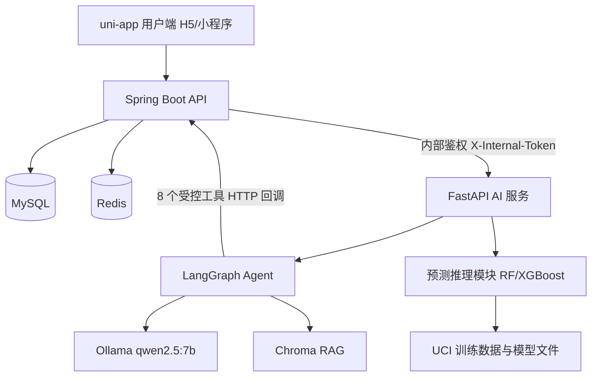

# 智能停车场管理系统 — 开发规划（LangChain 版）

> 项目：基于大语言模型与时序预测的智能停车场管理系统
> 周期：8 周 ｜ 形态：前后端分离 + 独立 AI 服务 + 预测模块 ｜ 部署：Docker Compose
> 本文件为架构决策定稿 + 开发排期，作为计划书的技术补充

---

## 1. 架构定稿

| 层 | 选型 | 说明 |
|---|---|---|
| 用户端 | **uni-app (Vue3 + TS)** | 一套代码 → H5 + 微信小程序。开发期先跑 H5，第 8 周再编译小程序 |
| 管理端 | Vue3 + TS + Element Plus + ECharts | 运营看板、停车场/车位/订单管理 |
| 业务后端 | Spring Boot 3.x + MyBatis-Plus + MySQL 8 + Redis + JWT + RBAC | **所有业务规则校验在此层**，AI 不可绕过 |
| AI 服务 | **单个 FastAPI 服务**（LangChain Agent + RAG + 预测推理合并） | 原计划书的"AI 服务 + 预测服务"两服务合并，联调成本减半 |
| LLM | Ollama + `qwen2.5:7b-instruct-q4_K_M` | 本机已验证：RTX 4060 8GB，响应 0.35s，原生支持 tool calling |
| Embedding | `bge-m3`（备选 `qwen3-embedding:0.6b`） | 均已在本机 Ollama 部署 |
| 向量库 | Chroma（persistent 模式，落盘挂载） | 单机够用，无需 Milvus |
| Agent 编排 | **LangChain + LangGraph** | 见 §2 |
| 预测 | pandas / scikit-learn / XGBoost，UCI Parking Birmingham | RF + XGBoost + 基线，时间序列划分 |
| 部署 | Docker Compose 6 容器：mysql / redis / backend / ai-service / admin-web / user-h5 | 小程序端不占容器 |

### 1.1 系统逻辑架构



---

## 2. LangChain 技术方案（核心决策）

### 2.1 版本锁定（第一优先级）

LangChain 生态版本漂移是最大风险，**全部锁定小版本并写入 requirements.txt / pyproject.toml**：

```
langchain==0.3.*
langchain-core==0.3.*
langchain-community==0.3.*
langchain-ollama==0.2.*
langchain-chroma==0.2.*
langgraph==0.2.*
chromadb==0.5.*
pydantic==2.*
fastapi==0.115.*
```

安装后立即 `pip freeze` 导出完整锁文件，Docker 镜像基于锁文件构建，杜绝"今天能跑明天不能跑"。

### 2.2 Agent 编排方式

| 方案 | 结论 |
|---|---|
| ❌ `AgentExecutor` (legacy) | LangChain 已将其标记为维护模式，不选 |
| ✅ **LangGraph `create_react_agent`** | 官方推荐的 tool-calling agent 方案，支持多轮工具循环、状态可查、可插入人工确认节点 |
| ✅ `@tool` 装饰器 + Pydantic 参数模型 | 自动生成 JSON Schema，qwen2.5 的 tool calling 直接消费 |
| ✅ `with_structured_output` | 意图解析输出结构化槽位（目的地/预算/时长/时间），比正则稳 |

**编排细节：**

- **意图解析**：独立一次 LLM 调用，`with_structured_output(ParkingIntent)` 输出结构化条件；解析失败降级为普通搜索
- **工具循环**：LangGraph ReAct 循环，`max_iterations=5` 防死循环，超限返回兜底提示
- **记忆**：`ai_conversation` / `ai_message` 表落库（业务库），LangChain 侧只维护单会话短期记忆（最近 6 轮），不做长期记忆——简化实现
- **流式输出**：LangGraph `astream_events` → FastAPI SSE → uni-app 打字机效果
- **可观测**：自研 callback handler 记录每轮 tool 名/参数/耗时/结果摘要入日志表；LangSmith 离线环境不启用

### 2.3 工具清单与权限模型

| 工具 | 权限约束 | 风险级 |
|---|---|---|
| `search_parking_lots(keyword, area, max_price, min_free)` | 无 | 低 |
| `get_parking_availability(lot_id)` | 无 | 低 |
| `get_parking_fee(lot_id, duration_minutes)` | 无 | 低 |
| `predict_occupancy(lot_id, horizon)` | 无 | 低 |
| `compare_parking_lots(lot_ids, weights)` | 无 | 低 |
| `get_user_parking_history(limit)` | **user_id 由后端注入，LLM 不可传参** | 中 |
| `create_reservation(lot_id, start, end)` | **两阶段确认 + 后端库存校验 + 唯一约束** | 高 |
| `cancel_reservation(reservation_id)` | **归属校验 + 状态机校验** | 高 |

**关键设计（防止 LLM 越权/幻觉）：**

1. **身份注入**：`user_id`、`role` 从 Spring Boot 透传的 JWT claims 注入工具闭包，**不作为 LLM 可填参数**——LLM 无法伪造他人身份
2. **两阶段确认**：`create_reservation` 首次调用只返回"预约草案 + 确认卡片"，用户在前端点击确认后，由**后端再次校验**（登录态、时段可约、车位余量、事务锁）才真正落库
3. **数值防幻觉**：system prompt 硬约束"所有空位/费用/预测数值必须来自工具返回"；工具结果附带 `source` 字段，前端展示可溯源
4. **降级开关**：`AI_ENABLED=false` 时所有 AI 入口回落普通查询页，业务系统独立可用（对应计划书 10.4）

### 2.4 RAG 链路

```
知识文档(md/pdf) → LangChain DocumentLoader → RecursiveCharacterTextSplitter(chunk=500, overlap=80)
→ OllamaEmbeddings(bge-m3) → Chroma 持久化
→ 检索: MMR(k=4) → 拼装 prompt → qwen2.5 生成 → 返回答案 + 来源条目
```

- 知识源：收费规则、预约/取消规则、停车 FAQ、管理制度（自编，标注来源）
- 管理端提供知识文档上传/删除接口，走 `knowledge_document` 表 + Chroma collection 同步
- 回答必须带来源（对应验收标准 §14.2）

### 2.5 AI 运营分析（后置项）

管理员自然语言 → 复用同一 Agent，但挂载"统计类只读工具"（`get_lot_usage_stats`、`get_revenue_trend`、`get_peak_hours`），**只暴露预定义查询，禁止 LLM 生成 SQL**。第 7 周有余量再做，否则用固定报表页替代。

---

## 3. 八周排期（LangChain 版）

| 周 | 主题 | 关键任务 | 交付物 |
|---|---|---|---|
| W1 | 需求/数据/骨架 | 数据清洗方案、ER 设计、三端骨架、Docker Compose 基础环境、**AI 服务依赖锁文件** | 需求文档、ER 图、可启动骨架 |
| W2 | 认证与基础业务 | JWT 登录注册、RBAC、停车场 CRUD、管理员关联 | 登录系统、停车场管理 |
| W3 | 车位/预约/订单 | 车位状态机、预约创建/取消、模拟入场离场、计费规则引擎、模拟支付 | 完整停车业务流程 |
| W4 | 用户端 + 看板 | uni-app H5 全部页面、停车场列表/详情/预约/订单、ECharts 运营看板 | 可演示用户端、管理看板 |
| W5 | 预测模块 | 数据清洗、特征工程、时间序列划分、基线/RF/XGBoost、评估、预测 API + 图表页 | 预测实验报告、模型文件、预测页 |
| W6 | **LangChain Agent** | 依赖锁定验证、意图解析、8 工具实现、LangGraph ReAct 编排、两阶段确认流、SSE 流式 | AI 助手（H5 可用）、工具调用演示 |
| W7 | RAG + 联调 | 知识文档入库、RAG 问答、异常兜底、全链路联调、（可选）AI 运营分析 | RAG 问答、联调版本 |
| W8 | 测试/部署/论文 | 功能/权限/Agent 越权测试、Compose 部署、小程序编译验证、论文与答辩材料 | 可部署系统、测试报告、论文 |

**LangChain 专项风险控制：**

- W1 就完成依赖锁定 + "Hello Agent"最小验证（一个工具 + 一次 tool call 跑通），**提前暴露版本问题**，不把风险留到 W6
- W6 前 3 天若 LangGraph 编排多次踩坑无进展，启用 Plan B：退回手写 tool loop 的薄封装层（工具定义与 schema 复用，切换成本 < 1 天）——这正是把 Agent 层做成薄封装的原因
- 所有工具实现与 LangChain 解耦：工具内部是纯 HTTP 调用后端，框架只负责编排，随时可替换

---

## 4. 接口契约（后端 ⇄ AI 服务）

| 接口 | 方法 | 说明 |
|---|---|---|
| `/api/ai/chat` | POST (SSE) | 对话入口，body: `{conversation_id, message}`，header 携带用户 JWT 透传 |
| `/api/ai/reservations/confirm` | POST | 确认预约草案，后端二次校验后落库 |
| `/api/ai/knowledge/upload` | POST | 知识文档上传（管理端） |
| `/internal/predictions/{lot_id}` | GET | 预测查询，`horizon=30|60|120`，内部 token 鉴权 |
| `/internal/lots` `/internal/availability` `/internal/fee` … | GET | 8 个工具对应的业务查询接口，统一内部鉴权 |

AI 服务不直连 MySQL——**所有业务数据通过后端 REST 获取**，保证权限与业务规则单一出口。

---

## 5. 验收对照（计划书 §14）

- [x] 基线 + RF + XGBoost 三模型对比，MAE/RMSE/MAPE/R²
- [x] 推荐排序（距离/价格/空位/预测拥挤度加权）
- [x] Agent 调用 ≥ 4 工具（实际 8 个）
- [x] 用户确认后创建预约（两阶段确认流）
- [x] RAG 问答带来源
- [x] Docker Compose 一键启动
- [x] 权限校验 + 关键操作日志

---

## 6. 下一步

1. 按 W1 搭项目骨架：`parking-backend` / `parking-ai` / `parking-admin` / `parking-user` + `docker-compose.yml`
2. AI 服务先跑通"依赖锁 + 最小 Agent 冒烟"（1 个工具 → qwen2.5 tool call 成功）
3. 同步细化 ER 设计与数据清洗方案
